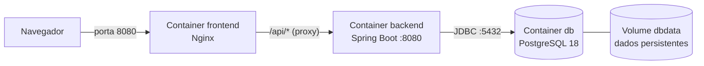
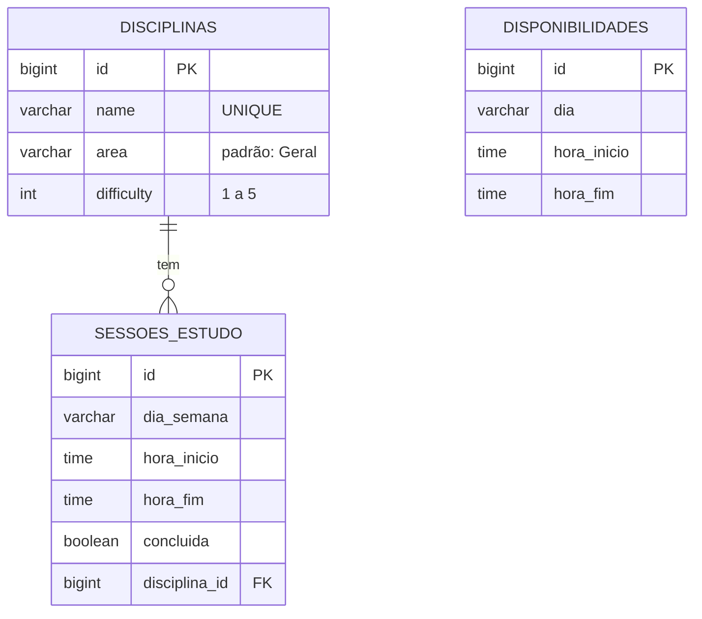

# DuckPlanner

Aplicação web que gera **cronogramas de estudo automáticos**. O estudante cadastra suas matérias (com nível de dificuldade de 1 a 5) e seus horários livres, e o sistema monta o cronograma da semana: sessões de 1 hora com 15 minutos de intervalo, dando mais tempo às matérias mais difíceis.

- **Equipe:** Angelina, Isabelly, Luisa, Maria Clara e Marina
- **Curso:** Técnico Integrado em Informática para Internet, IFAL, Campus São Miguel dos Campos
- **Turma:** 3º A, matutino
- **Docente:** Fernando Tenório

---

## Tecnologias

| Camada | Tecnologia |
|---|---|
| Front-end | HTML, CSS e JavaScript puro, servido pelo **Nginx** |
| Back-end | **Java 21** com **Spring Boot 3.3** (API REST, Spring Data JPA) |
| Banco de dados | **PostgreSQL 18** (relacional) |
| Deploy | **Docker** e **Docker Compose** (3 containers) |

---

## Arquitetura

O sistema roda em 3 containers. O navegador acessa só o Nginx, que entrega as páginas e encaminha as chamadas `/api/...` para o back-end. Só o back-end conversa com o banco.



**Camadas do back-end** (pacote `com.duckplanner`):

- `controller`: recebe as requisições HTTP e devolve JSON
- `dto`: formato dos dados trocados com o front-end
- `model`: entidades JPA, que representam as tabelas
- `repository`: acesso ao banco (Spring Data JPA)

---

## Modelo lógico do banco de dados



- Uma **disciplina** pode ter várias **sessões de estudo** (ao apagar a disciplina, as sessões dela também são apagadas).
- A tabela **disponibilidades** guarda os horários livres do estudante. O cronograma é gerado a partir dela e das disciplinas.
- O script de criação está em [`database/init.sql`](database/init.sql) e roda sozinho na primeira vez que o container do banco sobe.

---

## Como rodar

Pré-requisitos: **Docker Desktop** e **Git**.

```bash
git clone https://github.com/ClaraGomes0/duckplanner.git
cd duckplanner
cp .env.example .env
```

O arquivo `.env` guarda usuário e senha do banco (ele não vai para o GitHub, por isso é criado a partir do `.env.example`).

**Opção A: compilar as imagens na sua máquina**

```bash
docker compose up --build
```

**Opção B: usar as imagens prontas do Docker Hub**

```bash
docker compose pull
docker compose up
```

Quando o terminal mostrar `Started DuckPlannerApplication`, acesse:

| O quê | Endereço |
|---|---|
| Site | http://localhost:8080 |
| API (para testes) | http://localhost:8081/api/disciplinas |

Para parar: `Ctrl + C` e depois `docker compose down`.
Para apagar também o banco de dados: `docker compose down -v`.

---

## Imagens no Docker Hub

- Back-end: `claragomes/duckplanner-backend:1.0`
- Front-end: `claragomes/duckplanner-frontend:1.0`
- Banco: imagem oficial `postgres:18`

---

## API

O detalhamento está em [`docs/API.md`](docs/API.md).

| Recurso | Endereços |
|---|---|
| Matérias | `GET`, `POST /api/disciplinas`, `DELETE /api/disciplinas/{id}` |
| Disponibilidade | `GET`, `POST /api/disponibilidades`, `DELETE /api/disponibilidades/{id}` |
| Cronograma | `GET`, `PUT`, `DELETE /api/sessoes`, `PATCH /api/sessoes/{id}/concluida` |

---

## Estrutura do repositório

```
duckplanner/
├── backend/             # API Spring Boot + Dockerfile
├── frontend/            # páginas HTML/CSS/JS + Nginx + Dockerfile
├── database/init.sql    # script SQL (criação das tabelas)
├── docs/                # documentação da API
├── docker-compose.yml   # sobe os 3 containers
├── .env.example         # modelo das variáveis do banco
└── README.md
```

---

## Observações

- O **cadastro e o login** de usuários ficam salvos no navegador (`localStorage`). Matérias, horários e cronograma ficam no banco de dados PostgreSQL.
